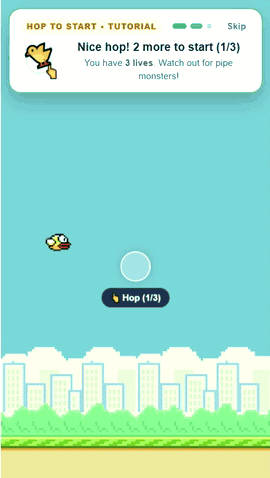
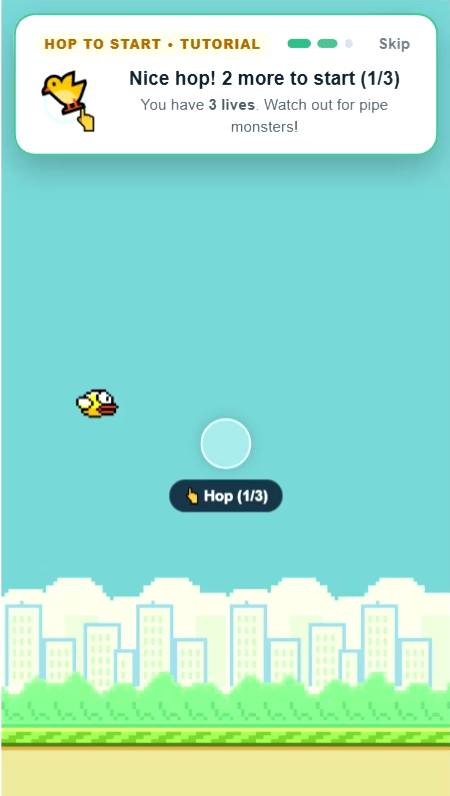
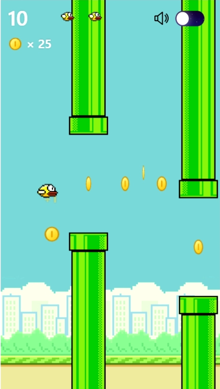
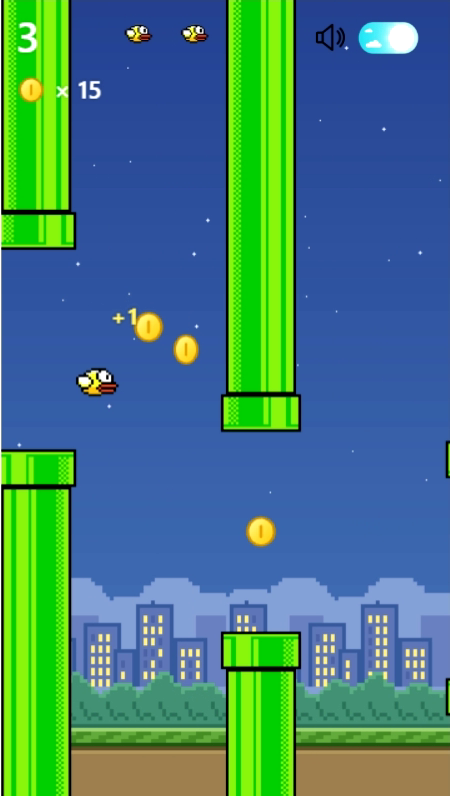
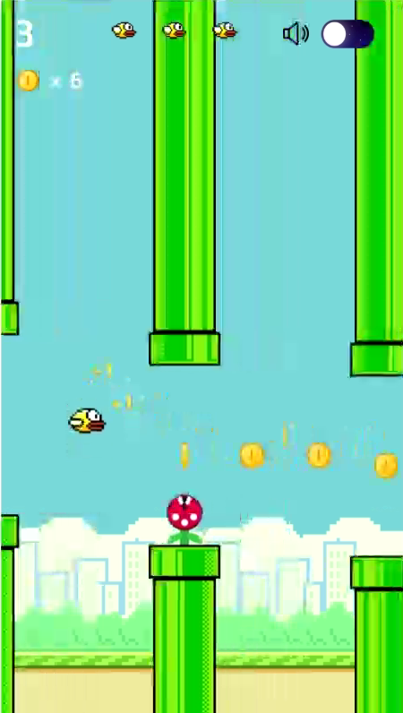
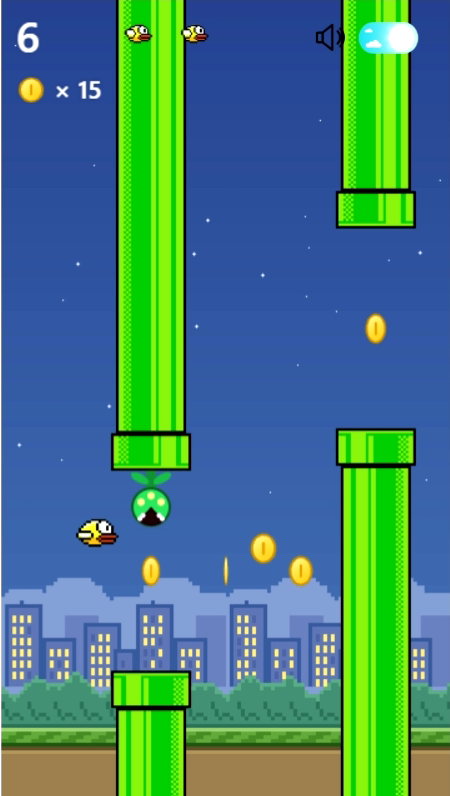
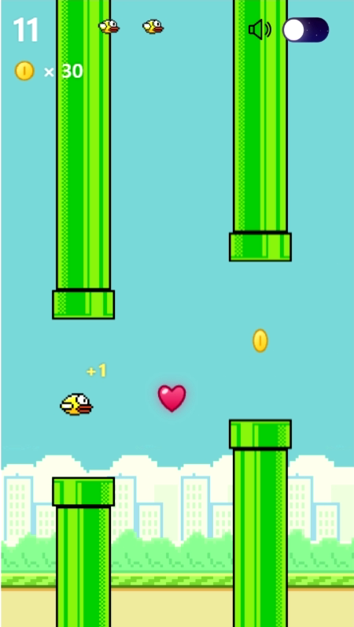
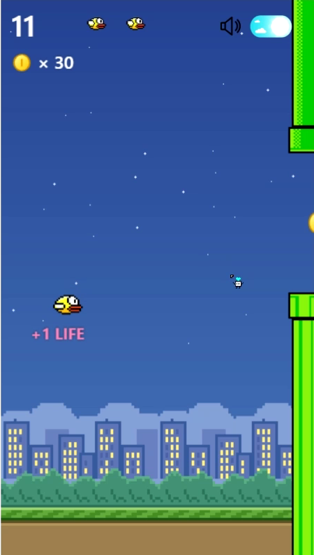
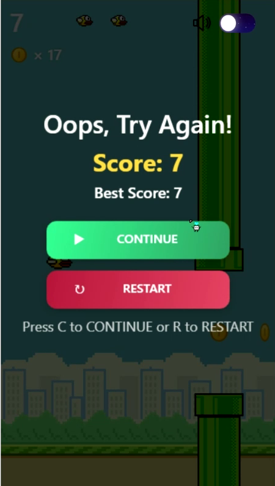

<h1 align="center">🐤
  <a href="https://lyuboslava1.github.io/Flappy-Bird/" target="_blank">
     Flappy Bird
  </a>
</h1>

  A Flappy Bird twist with coins, hearts, three lives, fireball-shooting piranha plants 
  and a day / night theme.

  
  
  

## 

### Contents

[Demo](#-demo) · [Features](#-features) · [How to play](#-how-to-play) · [Controls](#-controls) · [Credits](#-credits)

### Demo

  

### Gallery

<table align="center">
  <tr>
    <td align="center">
      
       <b>Hop-to-start tutorial</b>
    </td>
    <td align="center">
      
       <b>Day mode</b>
    </td>
    <td align="center">
      
       <b>Night mode</b>
    </td>
    <td align="center">
      
       <b>Piranha plant</b>
    </td>
  </tr>
  <tr>
    <td align="center">
      
       <b>Green Piranha plant</b>
    </td>
    <td align="center">
      
       <b>Heart pickup</b>
    </td>
    <td align="center">
      
       <b>+1 life restored</b>
    </td>
    <td align="center">
      
       <b>Continue or Restart</b>
    </td>
  </tr>
</table>

###  Features

- **Mario-style coins** that spin, show a floating `+1`, and sometimes appear in small arcs between the pipes.
- ❤️ **Three lives.** Lose one and you can **Continue** or **Restart**. Hearts occasionally appear and restore a lost life, up to a maximum of 3.
- 🌱 **Piranha-plant monsters** that pop out of the pipes. The red ones just bite, while the green ones also shoot fireballs.
- 🌗 **Day / night theme** with an animated lamp-style toggle switch that also swaps the background.
-  **Interactive tutorial.** Hop 3 times to start the game. It fades out on its own and can be skipped.
-  **Sound and music.** Background music, sound effects and a mute button. The music pauses while the "continue?" screen is shown.
-  **Score and best score** tracking.
-  **Mouse, touch and keyboard** controls.

### How to play

1. **Hop 3 times** to pass the tutorial and start the game (or press **Skip**).
2. Fly through the gaps between the pipes. Every pipe you pass is **+1 score**.
3. Collect coins on the way. They are counted separately from your score.
4. Watch out for piranha plants. Red ones bite, green ones also **shoot fireballs**.
5. Hitting a pipe or a monster costs **one life** (you start with 3). Choose **Continue** to keep going or **Restart** to begin again.
6. Collect a **heart** to win back a lost life (never above 3).
7. Flip the **lamp switch** in the top corner to change between day and night.

### Controls

| Action | Keyboard | Mouse / Touch |
|---|---|---|
| Flap / hop | `Space`, `↑` or `X` | Click / tap the game |
| Continue after losing a life | `C` | Click **CONTINUE** |
| Restart | `R` (or `Space` on Game Over) | Click **RESTART** |
| Mute / unmute | | Click the speaker icon |
| Day / night | | Click the lamp switch |

## Author

Created by **Lyuboslava Ivanova** 

💻 Frontend Developer | HTML • CSS • JavaScript • React

### Credits

Inspired by the original *Flappy Bird* by Dong Nguyen and Youtube Tutorial by Kenny Yip Coding. 

